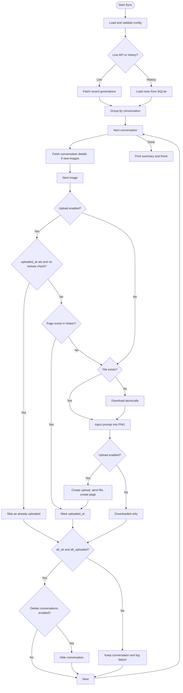

# Technical Requirements Document (TRD): c2n — ChatGPT to Notion Sync Tool

## 1. Introduction & Architectural Overview

This document translates the product goals in [requirement.md](requirement.md)
into the concrete architecture of the Rust implementation.

`c2n` is a local-first, rate-limit-resilient, scriptable CLI that acts as a
secure intermediary between ChatGPT generation history and a Notion database.

### Core Architecture Goals

- **Local Sovereignty**: Credentials, configuration, downloaded assets, and
  execution state live on the user's machine. No intermediary service is used.
- **Strict CLI Design**: No GUI. The binary is designed for terminal use, cron,
  and systemd timers.
- **Transactional Integrity**: Every state transition (discover → download →
  metadata → upload → cleanup) is tracked so interruptions can be resumed
  without duplicate uploads, resource leaks, or premature conversation deletion.
- **Safety First**: Destructive operations are gated by explicit verification
  and, for standalone library deletion, by `--yes`.

---

## 2. Technology Stack & Key Libraries

```text
┌────────────────────────────────────────────────────────┐
│                   Rust CLI Runtime                     │
├───────────────────┬───────────────────┬────────────────┤
│       Core        │    Networking     │  Persistence   │
├───────────────────┼───────────────────┼────────────────┤
│ Rust 2024 edition │ reqwest + rustls  │ SQLite (local) │
│ Tokio             │ backon retries    │ rusqlite       │
│ serde + toml      │ multipart/stream  │ backup API     │
└───────────────────┴───────────────────┴────────────────┘
```

1. **Language & Runtime**: Rust 2024 edition, Tokio multi-thread runtime.
2. **CLI**: `clap` derive with subcommands and typed options.
3. **HTTP**: `reqwest` with `rustls`, JSON, multipart, streaming, and query
   features. No OpenSSL dependency.
4. **Retries**: `backon::ExponentialBuilder`, up to 10 attempts, 2 s minimum
   delay, 60 s maximum delay. `Retry-After` is honored and capped at 60 s.
5. **Configuration**: `serde` + `toml`, with `deny_unknown_fields` and typed
   resolution of shared/account fallbacks.
6. **Persistence**: `rusqlite` with bundled SQLite and the backup API. WAL mode
   and a 10 s busy timeout are enabled.
7. **PNG metadata**: `img-parts` for `tEXt`/`iTXt` chunk editing; `tempfile` for
   atomic replacement.
8. **Presentation**: `comfy-table` for account-status tables, `indicatif` for
   progress, `tracing` for diagnostics, and a typed `Reporter` for user output.
9. **Email validation**: `email_address` for account-key validation.
10. **Time**: `chrono` + `chrono-tz` + `iana-time-zone` for timezone-aware
    account reporting and UTC-normalized timestamps.

### Module Layout

```text
src/
├── adapters/
│   ├── chatgpt.rs      # ChatGptApi trait + reqwest implementation
│   ├── filesystem.rs   # output root, path resolution, cleaning
│   ├── notion.rs       # NotionApi trait + upload/page implementation
│   └── sqlite.rs       # GenerationStore/NotionCache + rusqlite implementation
├── cli/app.rs          # clap definitions and handlers
├── config.rs           # TOML loading, validation, account resolution
├── domain/models.rs    # config/data models and resolved contexts
├── services/
│   ├── account_status.rs
│   ├── history.rs
│   ├── image.rs
│   └── upload.rs
└── shared/
    ├── constants.rs
    ├── http.rs
    ├── time.rs
    └── verbosity.rs
```

Traits are defined at external boundaries so services can be tested with fakes:

- `ChatGptApi`
- `NotionApi`
- `GenerationStore`
- `NotionCache`

---

## 3. Local Datastore & State Machine

### 3.1 `image_generations`

| Column | Type | Key | Description |
| :--- | :--- | :--- | :--- |
| `id` | TEXT | Primary Key | Unique ChatGPT image generation identifier. |
| `created_at` | TEXT | - | RFC 3339 UTC timestamp with microseconds. |
| `conversation_id` | TEXT | - | ChatGPT conversation identifier. |
| `message_id` | TEXT | - | Generative node ID where the image was returned. |
| `asset_pointer` | TEXT | - | ChatGPT asset pointer used for prompt lookup. |
| `url` | TEXT | - | Remote image URL. |
| `prompt` | TEXT | - | Original prompt injected into the image and Notion. |
| `uploaded_at` | TEXT | - | RFC 3339 UTC timestamp when Notion upload was committed. Empty means pending. |
| `account` | TEXT | - | Account email key that owns the row. |

Indexes:

- `idx_generations_account(account)`
- `idx_generations_created_at(created_at)`
- `idx_generations_uploaded_at(uploaded_at)`

### 3.2 `cache_data_sources`

| Column | Type | Key | Description |
| :--- | :--- | :--- | :--- |
| `db_id` | TEXT | Primary Key | Notion database ID. |
| `data_sources_json` | TEXT | - | JSON array of `{ "id": "..." }` data sources. |
| `expires_at` | TEXT | - | RFC 3339 UTC expiry (24 hours). |

The cache prevents repeated `GET /v1/databases/{id}` calls during duplicate
checks. Expired rows are deleted lazily.

### 3.3 State Invariants

1. A row is marked uploaded **only** after a successful Notion page creation or
   a positive remote Notion duplicate check.
2. When `--no-upload-to-notion` is active, rows are never marked uploaded.
3. A conversation is hidden only when every image in it is in the uploaded or
   already-uploaded state.
4. Library deletion is explicit: the standalone command requires `--yes`.
5. All timestamps written by the tool are UTC RFC 3339 strings. Local time is
   used only for display and date-boundary calculations.

---

## 4. Feature Flows

### 4.1 Image Sync Pipeline (`upload-to-notion`)

#### 4.1.1 Discovery

Two sources are supported:

- **Live API** (`default`): `GET /backend-api/my/recent/image_gen?limit=N`.
  Items are grouped by `conversation_id`. Conversation details are fetched at
  most once per conversation, and only when at least one image is not already
  indexed locally.
- **History replay** (`--from-history` / `--verify-history`): rows are read from
  SQLite. `--from-history` selects non-uploaded rows. `--verify-history` also
  includes uploaded rows so they can be audited against Notion. The default
  window is the last 3 days; `--all` removes it.

Prompt extraction walks the conversation mapping from the image node to the
nearest `user` message and takes its first text part. If the start node is
missing, the tool falls back to locating the node by `asset_pointer`.

#### 4.1.2 Per-Image Processing

```text
for each generation in conversation:
    if upload enabled:
        if uploaded_at set and remote checks disabled:
            skip as already uploaded
        if Notion page with title == file name exists:
            mark uploaded_at
            skip as already uploaded

    if local image file is missing:
        download to a temporary file
        persist atomically

    inject prompt into PNG metadata (idempotent, atomic)

    if upload enabled:
        create Notion file upload
        send file bytes
        create page with title, image, prompt Markdown, email
        mark uploaded_at
    else:
        return downloaded-only
```

File names are `<generation id><extension>`, where the extension comes from the
source URL and defaults to `.png`.

#### 4.1.3 Conversation Outcome and Cleanup

Each conversation tracks two booleans:

- `all_ok`: no image failed.
- `all_uploaded`: every image is `Uploaded` or `AlreadyUploaded`.

`--delete-conversation` sends
`PATCH /backend-api/conversation/{id}` with `{"is_visible": false}` only when:

```text
all_ok
&& all_uploaded
&& upload_to_notion
&& !from_history
```

If any image fails, or upload is disabled, the conversation is kept and a
verbose warning is emitted. A 404 response containing `conversation_deleted` is
treated as success.

#### 4.1.4 Failure Logging

With `--fail-log <PATH>`, each failed image appends one JSON object per line:

```json
{
  "id": "...",
  "conversation_id": "...",
  "url": "...",
  "prompt": "...",
  "stage": "notion_check|download|prompt|upload",
  "file": "....png",
  "error": "...",
  "timestamp": "2026-..."
}
```

A failed image does not abort the whole run; the conversation is marked failed
and processing continues with the next conversation. A failure to fetch
conversation details or persist the database aborts the run.

#### 4.1.5 System Flowchart



### 4.2 Notion Upload Details

1. `POST /v1/file_uploads` with `mode = single_part`, `filename`, and
   `content_type`.
2. `POST /v1/file_uploads/{id}/send` with multipart file bytes.
   - A `400` response is treated as “already uploaded”; the original upload ID
     is reused. This makes retries safe when the server committed the upload but
     the response was lost.
3. `POST /v1/pages` with:
   - `parent.database_id`
   - `properties.Name.title[0].text.content = <file name>`
   - `properties.Image.files[0] = { type: "file_upload", file_upload: { id } }`
   - `markdown` body (prompt normalized to LF):

     ~~~text
     **Prompt:**

     ```
     <normalized prompt>
     ```

     **Email:** <account email>
     ~~~

   - CRLF and CR are normalized to LF before building the body.
4. The page request is retried with the same upload ID, never by re-running the
   entire upload sequence.

Duplicate checks query each Notion data source:

```json
{
  "filter": {
    "and": [
      { "property": "Name", "rich_text": { "equals": "<file name>" } }
    ]
  }
}
```

A page is considered a duplicate when its `Name` title text exactly matches the
file name. If the database exposes no data sources, the duplicate check fails
closed instead of uploading without protection. Corrupt cached data-source JSON
is discarded and refreshed.

### 4.3 Account Status (`account-status`)

1. Resolve the requested IANA timezone, then fall back to the system timezone and
   finally UTC.
2. For each account, check whether any generations exist in SQLite.
   - No rows: the account is immediately `Ready`.
3. For today and yesterday:
   - Compute UTC bounds for the local calendar day.
   - `cooldown_threshold = now - 24h`.
   - Count total rows in the day and “active” rows created after the threshold.
4. Status:
   - `active_count == 0`: `Ready`.
   - `active_count == total`: `❌ (x/y to wait)`.
   - Otherwise: `⚠️ (x/y to wait)`.
5. Durations:
   - **Next Wait** = earliest active generation + 24h, displayed in local time.
   - **Next Cooldown** = next wait − now.
   - **Fully Ready In** = latest active generation + 24h − now.
   - **Total Wait** = latest active − earliest active.

Accounts without any data appear as ready in both tables. Accounts with data
but no activity on a given day appear only in the yesterday fallback row, which
is marked ready, matching the original tool's behavior.

### 4.4 Maintenance Commands

- **`clean-output-path`**: removes entries under `output/` except the database,
  `chatgpt.db-wal`, `chatgpt.db-shm`, `chatgpt.db-journal`, and `.gitkeep`.
- **`backup-db <TARGET>`**: uses `rusqlite::backup::Backup` to produce a
  consistent snapshot. Parent directories are created.
- **`restore-db <SOURCE>`**: uses the SQLite backup API into the live
  connection, then runs `PRAGMA wal_checkpoint(TRUNCATE)`. This avoids replacing
  the database file underneath open handles.
- **`delete-library [QUERY]`**: dry-runs by default and prints a count. With
  `--yes`, deletes matching images concurrently and prints the remaining count.
  Deletes use the ChatGPT `delete_stream` endpoint and parse SSE `data:` events.

---

## 5. Non-Functional Requirements & Design Patterns

### 5.1 Idempotency & Replay

- SQLite is the local source of truth.
- A crash at any point resumes from the failed item on the next invocation.
- A local row can be marked uploaded after a positive Notion duplicate check,
  repairing lost state.
- PNG prompt injection is idempotent and skips disk writes when the prompt is
  already present.

### 5.2 Network Rate-Limiting Resiliency

- `retry_http` wraps every API operation with `backon`.
- Retryable conditions:
  - HTTP 429
  - HTTP 5xx
  - Timeouts
  - Connection errors
  - Request/body/decode errors
- `Retry-After` is parsed from either seconds or an RFC 2822 date and capped at
  60 seconds. It cannot extend the retry budget past 10 total attempts.
- Retries are logged at `warn` level through `tracing`.

### 5.3 Memory and Disk Footprint

- Downloads stream response chunks into a temporary file.
- Notion multipart uploads use `Part::file`, avoiding loading the whole image
  into memory.
- PNG metadata edits parse only chunk headers and write through a temporary
  file.
- `clean-output-path` preserves the database and WAL/SHM/journal files.

### 5.4 Path Safety

- The output root is `<current working directory>/output`.
- Relative CLI and configured image folders are resolved under the output root.
- `..` components that would escape the output root are rejected.
- Symlinks inside the output root are resolved and rejected if they escape it.
- Downloaded filenames sanitize API-provided IDs so they cannot contain path
  separators.
- Absolute paths are allowed for explicit `--image-folder` values and configured
  absolute paths.
- `~` is expanded for configured paths and CLI values.

### 5.5 Testing Strategy

Tests target public behavior:

- Unit tests cover configuration validation, SQLite state transitions, timestamp
  formatting, PNG metadata round-trips, prompt extraction, and retry
  classification.
- Integration tests use `wiremock` for the ChatGPT and Notion adapters:
  - mixed string/number IDs
  - conversation deletion 404 semantics
  - atomic downloads
  - library pagination and SSE deletion
  - `Retry-After` handling and the 10-attempt cap
  - multipart upload and page payload shape
  - page-creation retry with the same upload ID
  - 400 “already uploaded” fallback
  - data-source cache reuse and fail-closed empty data sources
- The upload pipeline is tested with injected `ChatGptApi`/`NotionApi` fakes and
  a real temporary SQLite database:
  - `--no-upload-to-notion` never marks rows uploaded and never deletes
    conversations
  - download-only works without a database ID or Notion client
  - a verified upload marks the row and deletes the conversation
- SQLite tests cover corrupt cache recovery and backup/restore through the live
  connection.
- CLI tests cover argument conflicts without loading configuration.
- The suite must remain deterministic and green under `cargo test`.
